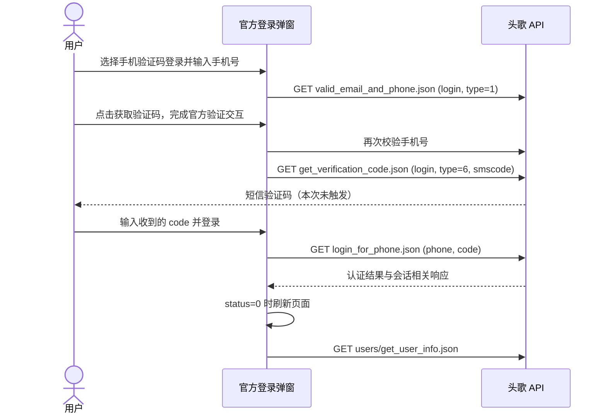

# 登录协议：账号密码、手机验证码与微信扫码

核对日期：2026-11-20。本文记录头歌官方 Web 客户端的登录协议，说明请求参数、状态流转、会话建立方式及验证范围。

当前头歌妈妈的 Go 客户端只实现账号密码登录。本文补充的是手机验证码与微信扫码的协议研究，未增加应用接口、前端入口或后端适配器。

## 1. 入口与验证范围

官方页面、接口和静态资源分属不同来源：

| 用途 | 来源 |
| --- | --- |
| 页面、OAuth 返回页 | `https://www.educoder.net` |
| 头歌业务 API | `https://data.educoder.net` |
| 当前 Web bundle | `https://www-cdn.educoder.net` |
| 微信二维码与授权 | `https://open.weixin.qq.com` |
| 本次实际观察的微信长轮询 | `https://lp.open.weixin.qq.com` |

`/user/login` 的独立页面包含账号密码表单和快速登录入口；手机验证码表单主要位于首页的全局登录弹窗中，不能只检查独立登录页的 chunk 就认定官方没有该功能。

本次使用当前官方 HTML、它引用的 JavaScript chunk、微信二维码页面及隔离浏览器记录交叉核对。以下标记用于区分结论来源：

| 标记 | 含义 | 本次结果 |
| --- | --- | --- |
| 静态确认 | 当前已发布脚本明确构造请求或读取响应字段 | 验证码发码/登录、微信回调/绑定的接口、方法、参数和客户端分支已确认 |
| 动态确认 | 本次浏览器实际产生的请求或页面状态 | 官方登录页、手机验证码表单、二维码页面及图片 HTTP 200、微信长轮询发起已确认 |
| 待验证 | 需要真实用户完成认证才能观察 | 短信送达、有效验证码登录、手机扫码并确认、回调成功会话、首次绑定成功等尚未执行 |

没有发送短信、提交短信验证码、扫码确认或修改账号绑定。文中的状态表来自客户端处理代码，不是对所有服务端状态的实测枚举；短信有效期、服务端限流、失败次数阈值及完整成功响应仍需真实认证样本确认。HTTP 200、二维码加载成功和前端 `status` 分支都不单独证明已经登录。

## 2. 三种方式的共同点与区别

| 登录方式 | 认证请求 | 关键输入 | 后续步骤 |
| --- | --- | --- | --- |
| 账号密码 | `POST /api/accounts/login.json` | `login`、加密 `password`、`autologin` | 接收头歌会话，再读用户身份 |
| 手机验证码 | `GET /api/accounts/login_for_phone.json` | `phone`、短信 `code` | 接收头歌会话，再读用户身份；可能进入账号绑定/考试提示分支 |
| 微信扫码 | 微信授权后，`GET /api/auth/wechat/callback.json` | 一次性微信 `code`，特定绑定场景另有 `signedState` | 接收头歌会话；已有用户读取身份，新用户按提示绑定手机号/邮箱 |
| 微信内浏览器 | `GET /api/auth/wechat/web_callback.json` | 同一 OAuth 返回流程的 `code` | 使用微信内授权入口，后续仍读取头歌身份 |

这里的业务 GET 不等于只读：发码、验证码登录和 OAuth code 消费都有状态变化或外部影响，不能套用课程目录的 GET 自动重试策略。

### 2.1 公共请求封装

验证码登录和微信回调复用普通头歌 API 请求封装，没有在所见客户端中另建 JWT 或 Bearer 流程。

| 项目 | 当前客户端行为 |
| --- | --- |
| 跨域凭据 | `credentials: "include"`，同时配置 `withCredentials: true` |
| 类型 | `X-EDU-Type: pc` |
| 时间戳 | `X-EDU-Timestamp`，`Date.now()` 毫秒值 |
| 签名 | `X-EDU-Signature`，当前公共请求签名 |
| 会话 | `Pc-Authorization`，读取官方 `_educoder_session` Cookie |
| 来源 | `Origin`、`Referer`、`X-Original-Protocol`、`X-Original-Host`、`X-Original-Origin` |
| 请求标识 | `X-Request-Id` |

当前脚本构造的公共签名形式如下；`AK`、`SK` 指前端公共协议常量，不是用户凭据，也不是微信 `appsecret`。仓库已有实现位于 `internal/educoder/client.go` 的 `Signature`，本次没有修改该实现。

```text
canonical = "method=" + UPPERCASE(METHOD)
          + "&ak=" + AK + "&sk=" + SK + "&time=" + TIMESTAMP_MS
X-EDU-Signature = lowercase_hex(MD5(Base64(canonical)))
```

本次初始页面请求已实际观察到这些请求头的名称，未保存或发布头值。官方 XHR 拦截器还有带复数后缀的 `X-EDU-Timestamps` / `X-EDU-Signatures` 分支；本文认证 service 使用的 fetch 封装采用上表单数名称，二者不应混写成同一次请求的必填字段。

### 2.2 Cookie、`cs` 与身份确认

当前前端请求封装会读取响应头 `cs`，存在时通过公共 Cookie 工具更新 `_educoder_session`。该工具在官方域设置 `domain=.educoder.net; path=/; SameSite=None; secure`，调用传入的客户端保存天数为 1。这仅描述前端工具的设置，不证明服务端会话真实有效期等于一天，也不是本次观察到的 `Set-Cookie` 完整属性。

因此，未来适配需要同时核对普通 `Set-Cookie` 和 `cs` 两条来源，不能假定所有登录方式都与现有密码登录的 Cookie 响应完全一致。现有 Go `Login` 当前依赖 CookieJar 中的 `_educoder_session`；新增方式是否需要处理 `cs`，应由真实响应确认后实现。

完成认证后用**同一上游会话**读取用户身份：

```http
GET /api/users/get_user_info.json
Host: data.educoder.net
```

微信 callback 本身 dispatch 的参数为 `{}`；其他页面初始化会按场景加入参数，本仓库现有 Go `UserInfo` 使用 `school=1`。该参数不是微信登录成功的必需字段。将来接入头歌妈妈时，仍须用这一步返回的有效数字用户 ID 建立平台身份，不能把输入手机号、微信 code、二维码 UUID、`new_user` 标志或 HTTP 200 当作平台用户身份。

头歌 Cookie、`cs` 和 OAuth code 不等于头歌妈妈自己的 HttpOnly 站内会话。浏览器在 `.educoder.net` 的 Cookie 不会自动发送到 `touge.mom`，也不会自动进入服务器的 Go CookieJar。

## 3. 手机验证码登录

### 3.1 时序



### 3.2 手机号和表单

当前手机号表单正则为 `^(1[0-9])\d{9}$`，长度上限 11，拒绝空格。它只表达“11 位且以 1 开头”，不是完整的运营商号段规则。

短信 `code` 字段在所见普通登录表单中校验非空，未发现可据以声明“服务端严格要求 6 位数字”的依据。其他验证/绑定表单的 6 位规则不能直接套到这个接口。

表单展示“下次自动登录”并设置初始 `autologin=true`，但普通验证码登录回调只转发 `phone` 和 `code`。不能因为 UI 中存在勾选框就在请求里补一个 `autologin`。

### 3.3 手机号存在性检查

**静态确认：**

```http
GET /api/accounts/valid_email_and_phone.json?login=PHONE&type=1
Host: data.educoder.net
```

| 参数 | 值/来源 |
| --- | --- |
| `login` | 用户输入的手机号 |
| `type` | 数字 `1`，此处是校验接口的类型，不是发码接口的类型 |

表单失焦时调用一次；发码前重复调用。失焦分支把负 `status` 作为已有账号，发码分支在 `status > 0` 时提示“该手机号码不存在，请先注册”并停止。两个调用点的判断并不完全相同，未来客户端不能将所有负状态统称为“请求成功”；完整状态含义应根据响应和实际账号验证。

### 3.4 获取短信验证码

**静态确认：**

```http
GET /api/accounts/get_verification_code.json?login=PHONE&type=6&smscode=SMS_REQUEST_DIGEST
Host: data.educoder.net
```

| 参数 | 值/来源 |
| --- | --- |
| `login` | 同一个手机号 |
| `type` | 手机登录为数字 `6` |
| `smscode` | `setmiyah(login)` 的结果，详见下式 |

```text
SMS_REQUEST_DIGEST = lowercase_hex(MD5("79e33abd4b6588941ab7622aed1e67e8" + PHONE))
```

这是当前前端公开常量参与的派生字段，不是用户收到的短信验证码。调用发生在官方验证交互的成功回调之后；本次未完成该验证交互，也未触发发码。所见调用点没有将额外验证码 ticket 放入该请求，这只能说明本次客户端的字段构造，不能推断服务端没有风控、限流或额外验证。

UI 在发码请求结束后设置 60 秒重发倒计时，即使响应为负状态也可能进入倒计时；负状态的 `message` 显示在验证码字段。**60 秒是客户端按钮冷却，不是已验证的验证码有效期。** 手机/邮箱绑定页面另以 `status===1` 提示发送成功；不能将这个绑定分支的判断未经实测写成普通登录发码接口的完整响应契约。

同一发码接口的类型容易混淆：

| `type` | 已观察用途 |
| --- | --- |
| `1` | 注册 |
| `2` | 找回/重置密码 |
| `3` | 绑定手机，包括新微信身份绑定页面 |
| `4` | 绑定邮箱 |
| `6` | 手机验证码登录 |

### 3.5 用短信验证码登录

**静态确认：**

```http
GET /api/accounts/login_for_phone.json?phone=PHONE&code=SMS_CODE
Host: data.educoder.net
```

普通调用仅包含这两个业务参数；没有 `password`、`login`、`type`、`smscode` 或 `autologin`。短信 code 放在 query 中是当前官方协议，未来实现需要避免让请求 URL 进入普通访问日志、任务诊断和工单正文。

| 前端识别的结果 | 后续行为 |
| --- | --- |
| `status===0` | 刷新页面，随后读取用户身份 |
| `status===-4` | 关闭登录框，进入账号绑定/身份补充弹窗，保留响应 `user` 和原表单数据；不是登录成功终态 |
| `status===-5` | 显示考试登录限制提示，进入用户主动处理的解锁交互；不是普通验证码错误 |
| 其他负状态 | 显示 `message`，不能进入成功态 |

考试解锁界面存在对同一登录 service 传入额外 `unlock_key` 的专用分支；这不是普通短信登录的必需字段，不能默认生成或自动重试。验证码错误、过期、次数限制的具体错误码本次未实测，文档不补造枚举。

## 4. 微信扫码登录

### 4.1 桌面二维码入口

官方桌面布局直接将微信授权页放进 iframe：

```text
https://open.weixin.qq.com/connect/qrconnect
  ?appid=wx6b119e2d829c13fa
  &redirect_uri=https%3A%2F%2Fwww.educoder.net%2fotherloginstart
  &response_type=code
  &scope=snsapi_login
  &state=null,www.educoder.net
  #wechat_redirect
```

上述 `appid` 是公开的微信客户端标识，不是 `appsecret`。`redirect_uri` 的实际返回路径是 `https://www.educoder.net/otherloginstart`，序列化时按 URL query 编码一次。当前桌面弹窗还使用 `stylelite=1`；其 iframe 每 5 分钟刷新并追加时间参数 `t`。这表示客户端刷新计划，不保证微信二维码 TTL 就是 5 分钟。

这里没有发现头歌业务 API 的“创建二维码任务”或“查询扫码状态”调用；已观察的二维码和状态轮询由微信 iframe 发起。

### 4.2 二维码与长轮询

```text
GET https://open.weixin.qq.com/connect/qrcode/QR_UUID
GET https://lp.open.weixin.qq.com/connect/l/qrconnect?uuid=QR_UUID[&last=WX_STATUS]
```

本次隔离浏览器实际观察到授权页和二维码图片 HTTP 200，以及 `lp.open.weixin.qq.com` 长轮询发起；长轮询在观察窗口结束时尚未返回，不能据此声称已扫码。当前二维码 HTML 还保留 `long.open.weixin.qq.com` 的兼容分支。

轮询由 script 加载响应 JavaScript，单次脚本请求 timeout 为 30,000ms，使用 `window.wx_errcode`，不是已确认的 JSON API。当前脚本的分支如下；这些是代码分支，除二维码加载外，本次没有逐一触发：

| `wx_errcode` | 当前微信页面行为 |
| --- | --- |
| `404` | 显示已扫码状态，约 100ms 后带 `last` 继续轮询 |
| `405` | 授权已确认，使用返回的 `wx_code` 导航至头歌回调页 |
| `403` | 显示取消状态，约 2s 后继续 |
| `402` | 显示过期/刷新界面 |
| `408` | 等待/超时分支，约 2s 后继续，另有快速登录状态判断 |
| `500` | 约 200ms 后刷新二维码 iframe |

不要执行网络返回的任意脚本文本来提取状态；如未来使用协议客户端，应针对已核对的字段形态解析，保留不可识别响应。二维码 UUID 只标识这次二维码，不能作为头歌会话。

### 4.3 回调页与头歌认证接口

微信确认后，浏览器先进入官方页面路由：

```text
https://www.educoder.net/otherloginstart?code=WX_CODE&state=STATE_VALUE
```

这个页面读取 `code`、`state`，将 state 按逗号拆为 `[action, returnHost, signedState]`：

| state 形式 | 用途 |
| --- | --- |
| `null,HOST` | 普通桌面二维码登录 |
| `account,HOST,SIGNED_STATE` | 已登录账号绑定微信，不是普通登录 |
| `null` | 独立 `/wxlogin.html` 二维码入口 |
| `STATE` | 微信内浏览器 OAuth 入口的当前字面值 |

**静态确认：**该页面通过共用 GET helper 调用以下接口，而不是把页面路由本身当作 API：

```http
GET /api/auth/wechat/callback.json?code=WX_CODE
Host: data.educoder.net
```

UA 匹配 `MicroMessenger` 时改为：

```http
GET /api/auth/wechat/web_callback.json?code=WX_CODE
Host: data.educoder.net
```

callback 调用构造 `{code, signedState}`，普通两段 state 的 `signedState` 为 `undefined`，公共 query 序列化省略该项；只有原 state 第三段存在时才附带。`state` 本身由回调页消费，不作为同名参数转发给该接口。`web_callback` 的选择来自当前 UA，而不是二维码 URL 的 scope 自动选择。

| callback 字段/状态 | 当前前端行为 |
| --- | --- |
| `status===0` | 首先调用 `user/getUserInfo`，然后决定是否绑定/跳转 |
| `new_user` 为真 | 进入 `/otherlogin?type=wechat` |
| `status===-3` | 提示存在限制登录的考试，使用账号密码登录；确认后返回首页 |
| 其他状态 | 组件没有独立的完整错误枚举，由公共请求错误处理或后续验证处理 |

对已有用户，回调页在 `status===0` 后按来源返回。它使用 `returnHost`、`action` 和 localStorage 的 `addinfo` / `classromeurl`：普通 host 回跳与 `action=account` 的 `/account/binding` 不同；移动入口优先恢复原页面。以上字段是页面导航信息，不是可信用户身份。上游的 `null,HOST` 或字面量 `STATE` 也不构成本站的随机登录事务标识；未来实现应独立关联发起人、一次登录事务和会话，验证来源及返回目标，不能照搬任意 host 跳转为本站会话关联依据。

客户端没有展示微信 `appsecret` 或服务端向 `/sns/oauth2/access_token` 交换 token 的代码。当前只能确认浏览器将 code 交给头歌 callback；服务端如何兑换 `openid/unionid`、关联账号及设置会话，需真实 callback 样本或服务端实现证明。

### 4.4 新微信身份绑定手机号或邮箱

`new_user` 后进入的 `/otherlogin?type=wechat` 是账号绑定页面，不是再做一次普通短信登录。页面先验证用户输入为手机或邮箱，并要求用户同意相应服务条款后才提交。

1. 获取绑定验证码：

   ```http
   GET /api/accounts/get_verification_code.json?login=PHONE_OR_EMAIL&type=BIND_TYPE&smscode=REQUEST_DIGEST
   Host: data.educoder.net
   ```

   手机 `BIND_TYPE=3`，邮箱 `BIND_TYPE=4`；`REQUEST_DIGEST` 同样来自 `setmiyah(login)`。此页面将 `status===1` 解释为已发送，并显示 60 秒倒计时。

2. 绑定请求：

   ```http
   POST /api/bind_user.json
   Host: data.educoder.net
   Content-Type: application/json

   {"login":"PHONE_OR_EMAIL","code":"USER_RECEIVED_CODE","type":"wechat"}
   ```

3. `status===0` 后重新读取 `get_user_info`，再返回原页面或首页。

该请求没有携带 `openid`、`unionid` 或原微信 code，绑定对象依赖前一步 callback 建立的上游会话。因此 callback、发码、绑定、用户信息读取必须属于同一用户和同一 CookieJar；缺少这个关联的独立 POST 不能视为完整绑定协议。

已登录用户主动“绑定微信”是另一个场景：当前账号绑定页面生成 `account,HOST,SIGNED_STATE`，第三段由当前 login 与前端公共协议常量派生。普通扫码登录不需要这段，也不应自动进入绑定/解绑流程；相关入口为 `/account/binding`，本次未操作账号绑定或解绑。

### 4.5 手机浏览器和微信内浏览器

全局登录弹窗在移动设备或微信环境调用 `toWechatLogin`，先记录 `addinfo=1` 与原页面 `classromeurl`：

| 环境 | 当前入口 |
| --- | --- |
| 微信内浏览器（排除所见小程序环境检测） | `https://open.weixin.qq.com/connect/oauth2/authorize` |
| 非微信移动浏览器 | 官方 `/wxlogin.html`，其中嵌套二维码 iframe |
| 普通桌面浏览器 | 登录弹窗中的二维码 iframe |

微信内浏览器的授权 URL 构造：

```text
https://open.weixin.qq.com/connect/oauth2/authorize
  ?appid=wx0955caba88bc37eb
  &redirect_uri=https%3A%2F%2Fwww.educoder.net%2fotherloginstart
  &response_type=code
  &scope=snsapi_userinfo
  &state=STATE
  #wechat_redirect
```

上述为移动分支 APPID；当前函数还保留使用桌面 APPID 的非移动分支。独立 `/wxlogin.html` 的 iframe 使用桌面 APPID、`scope=snsapi_login`，但 state 是单独的 `null`。这些入口的 scope、APPID 和 state 不能统一成同一个固定模板。

## 5. 未来适配时必须验证的接口契约

以下为协议实施所需的验证条件，本次没有实现这些功能：

| 环节 | 需要补充的真实证据 |
| --- | --- |
| 手机发码 | 使用本人手机号完成官方交互，记录脱敏的 HTTP/status/字段名及发送结果；不留手机号/验证码原值 |
| 手机登录 | 一次有效 code 的成功响应、`Set-Cookie`/`cs` 是否存在、同会话用户数字 ID |
| 短信失效/限流 | 官方实际返回的分类和等待提示；客户端 60 秒不能代替服务端 TTL |
| 微信确认 | 用户实际扫码并确认后，官方返回路由、callback 方法与字段、最终同会话身份 |
| `new_user` | 如确实遇到，再由用户完成账号绑定与条款确认，核对绑定前后身份及 session 关联 |
| 浏览器与 Go 会话衔接 | 明确已授权 OAuth code 如何到达 Go 认证流程；验证官方回调域限制，不能假定二维码显示即建立本站会话 |
| 取消/超时/重启 | 本次二维码或验证码是否仍有效、是否已被消费；用户重新发起与网络自动重放须分开 |

官方 APPID 的回调域已在其微信开放平台配置。静态客户端不能证明可以把 `redirect_uri` 任意改成 `touge.mom`；浏览器同源规则也阻止本站直接读取官方域回调页面的会话。未来方案必须先解决授权返回和会话衔接，再接到本站现有的数字用户身份核验与 HttpOnly 会话流程。

当前仓库的 `internal/educoder/client.go`、`internal/web/platform_auth.go`、`internal/platform` 可以作为现有密码登录及平台身份边界的参照；本文没有开放新的站内 API。微信 iframe、短信登录参数、Cookie、`cs`、授权 code 和二维码 UUID 均不进入题库、任务持久化、镜像、Git 或公开错误文本。原始取证在忽略目录保留，Git 只收录字段说明和脱敏证据索引。

## 6. 证据索引与复核方法

### 6.1 当前静态资源

以下文件均于本次从当前 HTML 或主包明确引用的精确资源 URL 取得；它们的正文未进入仓库。哈希用于识别本次核对的版本，不代表上游接口永不变化。

| 资源（`www-cdn.educoder.net`） | 用途 | SHA-256 |
| --- | --- | --- |
| `umi.78507fdd.js` | API service、公共请求封装、签名、会话工具、chunk 映射 | `41495f75f2d2852858ecf5a78c4aaed6fb5340d52bf252059d089333aff20fa2` |
| `layouts__index.dbd34964.async.js` | 全局短信表单与微信弹窗 | `63bc700c9f16ebdeb7ee0bb58cb1afafebd9344b8f39ae9f162a7f2f294111f4` |
| `layouts__LoginAndRegister__index.7e7a222c.async.js` | 独立登录布局微信入口 | `d54a5e3f98b3a7f21cac296d29a26e3e6533980a94a584eb364686a271fd6cac` |
| `p__User__WechatLogin__index.1c71d035.async.js` | `/otherloginstart` | `319f6274d59d704a80ac6382a27703fba39a7f07f164a3e9ab74f2beb34d9597` |
| `p__User__BindAccount__index.4c17aad7.async.js` | `/otherlogin` | `9573c524b2e8b23bdd7f68dfbc352b68b259783124a8c2849b0f9bdac70627d7` |

官方 `https://www.educoder.net/wxlogin.html` 本次 615 字节，SHA-256 为 `f01045cefeed4276914124e5f7c08b8d1506942e492558ddd73c906951c9e356`。微信二维码 HTML 含本次临时二维码数据，每次可能变化；本次响应 SHA-256 为 `bb0c222cdfdb205e927bf3673111e8af3ca9d060abf80e8584898b82ecb02343`，仅保留本地原件，不发布临时二维码或授权链接。

定位时应以文件哈希、模块和精确文本为准，不能只用压缩脚本行号：

| 静态定位 | 关键观察 |
| --- | --- |
| 当前主包 service 模块 `565900` | `valid_email_and_phone.json`、`get_verification_code.json`、`login_for_phone.json` |
| 当前主包模块 `733170` | callback GET helper 与 `bind_user` POST helper |
| 当前主包 `setmiyah` / `setHeader` / `headers.get("cs")` | 发码摘要、公共签名、会话更新 |
| 当前布局短信发送/登录调用点 | `type:6` 与 `{phone:login,code}` |
| chunk `27333` | `state.split(",")`、`web_callback/callback`、`new_user` |
| chunk `27178` | 绑定发码 `type:3/4` 与 `bind_user.json` |

### 6.2 动态观察

REA 隔离浏览器使用空存储，结束后已终止其自有进程。本次完成以下动作：

1. 打开 `/user/login`，记录其实际脚本、API 来源和公共请求头名称。
2. 打开官方首页，点击“登录”，再点击“手机验证码登录”；最终可访问树包含手机号、验证码、获取验证码及登录控件。未填写手机号或验证码。
3. 打开 `/wxlogin.html`，观察 `qrconnect`、二维码图片及微信长轮询请求；未扫码。

相关 REA 原始证据 ID：登录加载 `ev_039d64418b01cb18b3678b02195f888b9e0d8e07bfa0355aaf3c61e800f95ad2`；短信 UI `ev_da5cd8876088eb6ea86ec0a21347268a1593cdc961081a7a3e4cc3d8ceb6ea61`；二维码 `ev_101da7579b1cc504126abc6956c488334d9854d44b63ad1f0462e0712fc7293d`。观察窗口有限，二维码轮询尚未终结，部分第三方资源失败；不能用本次抓取声明认证流程已完整跑通。

静态 REA 解析未执行目标 JavaScript，所选脚本语法解析成功，但大型布局的语义图达到保留预算，动态调用关系有未解析项。本文的方法/字段结论还逐一核对了当前 service、调用点及回调组件原文，不以完整调用图或历史 HAR 替代当前接口证据。

## 7. 文档边界

本文是 2026-11-20 的接口与客户端流程记录。新增功能前应重新确认当前静态资源版本、完成真实用户授权下的成功样本，并根据上游实际响应更新字段与状态。普通项目启动、测试、发布、部署和数据备份分别见 [README](../README.md)、[平台说明](PLATFORM.md) 与 [部署说明](../deploy/README.md)。
